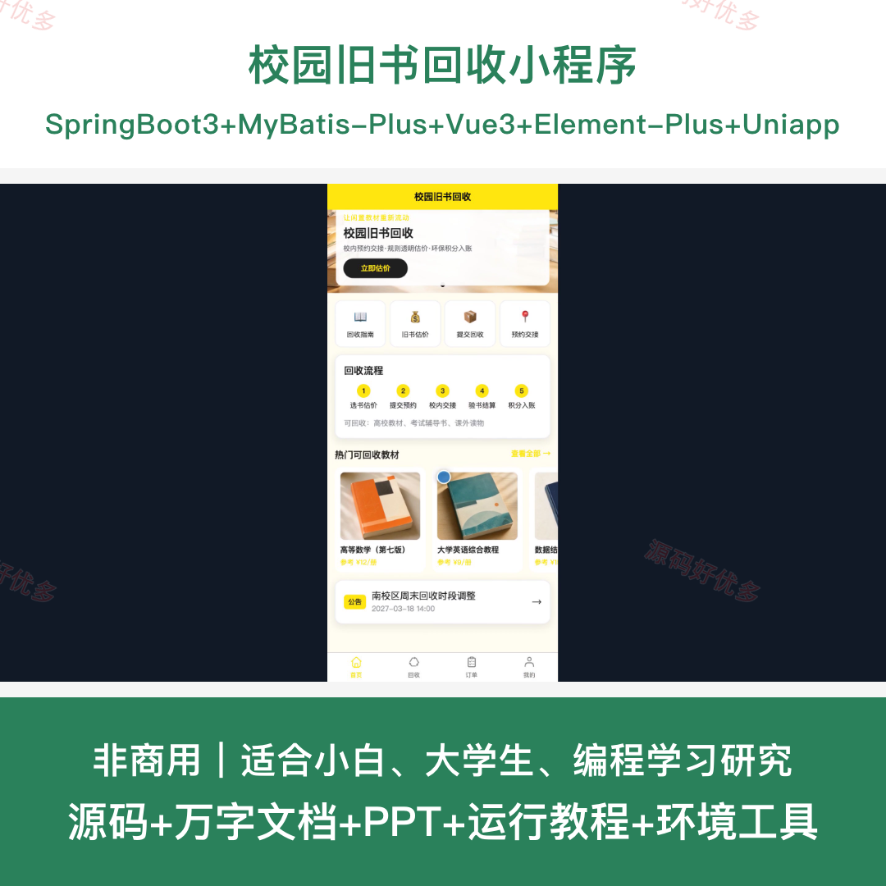
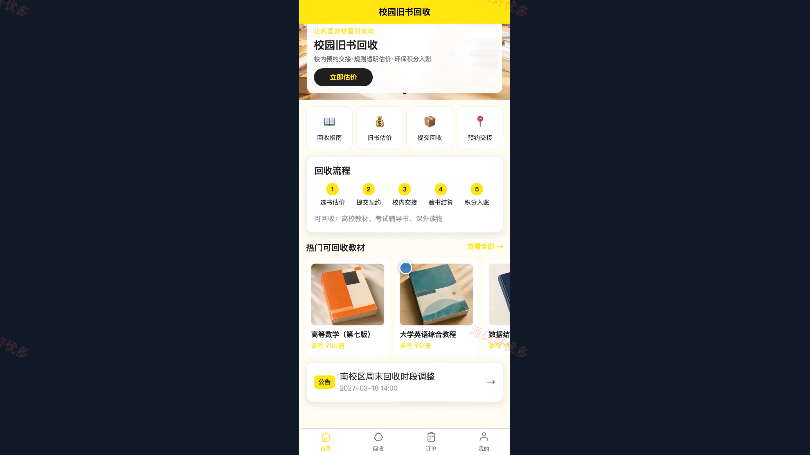
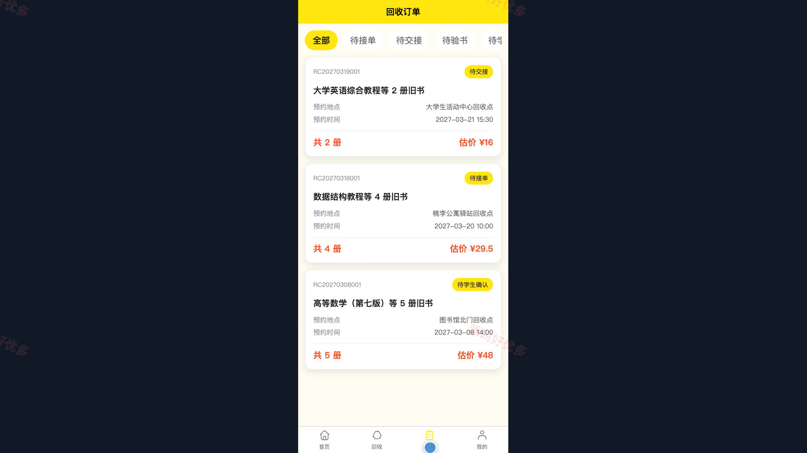
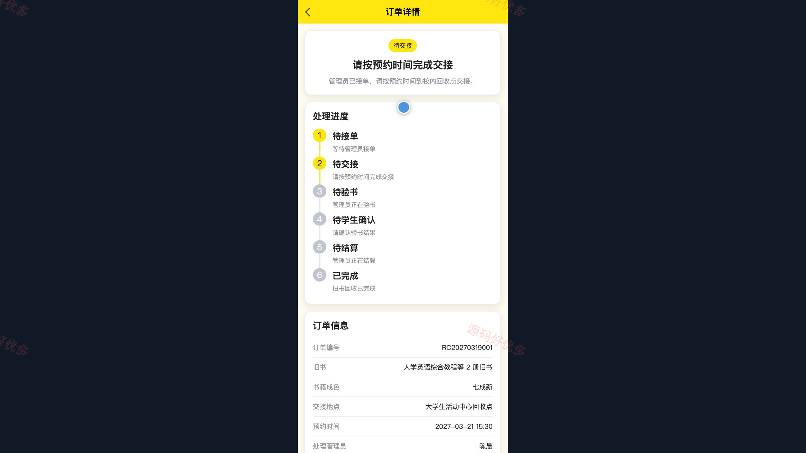
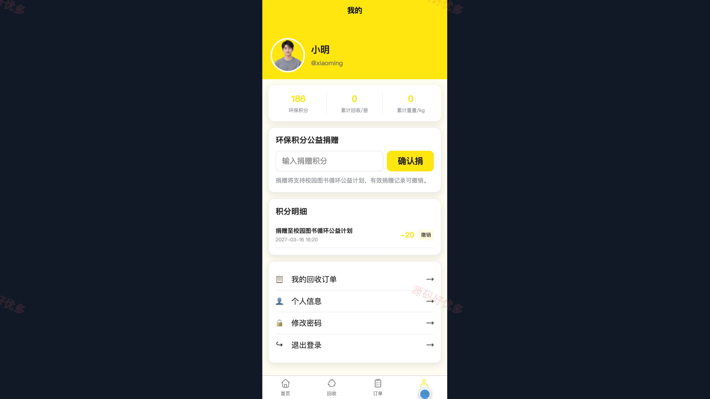
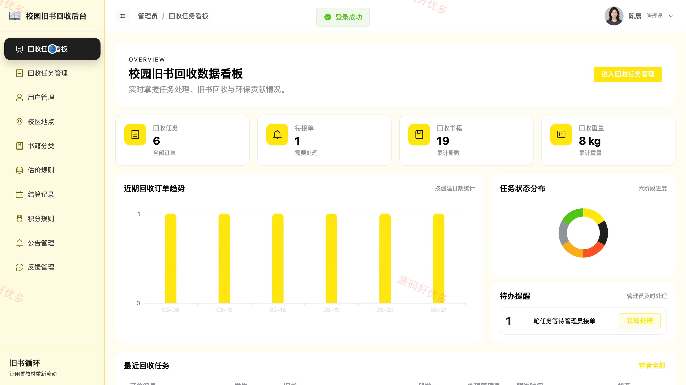
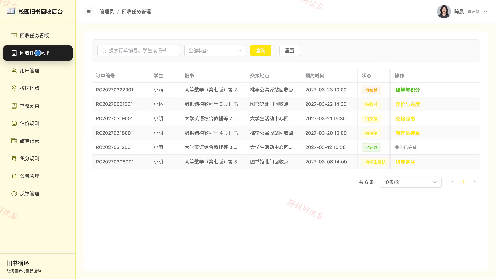
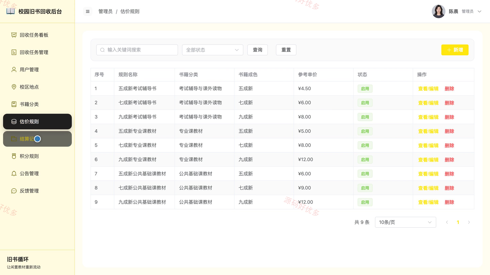

## 源码问题查看主页咨询

### 一、关键词
校园旧书回收、二手书回收、闲置教材回收、旧书估价、图书循环利用

### 二、作品包含
源码+数据库+万字设计文档+PPT+全套环境和工具资源+本地部署教程

### 三、项目技术
前端技术： Html、Css、Js、Vue3.4、Element-Plus、uniapp
后端技术：Java、SpringBoot3.2.0、MyBatis-Plus

### 四、运行环境要求
开发工具：IDEA/eclipse + VSCODE + HBuilder X + 微信开发者工具

数据库：MySQL5.7+（共17张表）

数据库管理工具：Navicat10以上版本

环境配置软件： JDK17 + Maven3.6.3

前端Nodejs：20.20.2

浏览器：谷歌浏览器

### 五、项目介绍
项目编号：bs109B

校园旧书回收小程序面向学生用户与管理员，串联回收指南、旧书估价、回收申请、校内交接、验书定价、结算确认、环保积分和评价反馈，并由后台完成用户、基础数据、公告与回收任务维护。

角色：学生用户、管理员

学生用户功能：注册登录、回收指南与旧书估价、提交回收订单、预约校内交接、回收进度跟踪、结算确认、环保记录查询、评价反馈。

管理员功能：回收任务看板与接单、交接验书、定价与进度维护、结算与积分发放、学生用户管理、校区地点及书籍分类与估价规则管理、公告与反馈管理、回收数据统计。

### 六、运行截图

